---

**Brecha digital y no uso de internet en estudiantes de 6-17 años: integración ENAHO-ESCALE 2025**

Inteligencia Artificial | Ingeniería de Sistemas | Universidad Peruana Unión

Docente: Mg. Angel Rosendo Condori Coaquira

## Resumen

Se integraron ENAHO y ESCALE 2025 para analizar 16 544 residentes de 6-17 años matriculados y asistentes a primaria/secundaria. El objetivo fue clasificar el **no uso de internet en el mes anterior**, indicador operativo que no mide competencias digitales. Se compararon dos métodos de agrupamiento y cuatro clasificadores mediante cinco folds por conglomerado. CatBoost obtuvo la mayor AP de validación; en prueba alcanzó ROC-AUC=0.820, AP=0.601 y F1 macro=0.693. Los perfiles presentan no uso ponderado entre 21.1% y 47.7% en desarrollo. Se auditaron estabilidad del clustering, estrategias de peso y explicaciones SHAP del ganador y de un árbol no lineal. El diseño es transversal; los resultados describen asociaciones predictivas y requieren validación externa.

**Palabras clave:** ENAHO; ESCALE; brecha digital; validación agrupada; clustering; SHAP.

## 1. Problema, medición y alcance

La conexión del hogar no garantiza el uso efectivo de internet. Se busca identificar perfiles socioeconómicos y tecnológicos, comparar modelos de no uso y explicar sus decisiones con contexto educativo de distrito y área [1-3]. La cohorte contiene 4 294 no usuarios y 12 250 usuarios: 26.0% muestral y 22.7% ponderado, sin presentarlo como tasa oficial nacional. Clase 1: P314A=2; clase 0: P314A=1; ausencias y pases no se convierten en ceros.

Antes de modelar se contrastó el desfase edad-grado: los umbrales de uno y dos años produjeron 6 707 y 679 positivos, respectivamente. No se reconstruyó edad al 31 de marzo en esta integración; el desfase observado varía con el mes y no equivale al indicador ESCALE [4]. Se eligió no uso por su medición directa, sin comparar AUC para decidir la etiqueta.

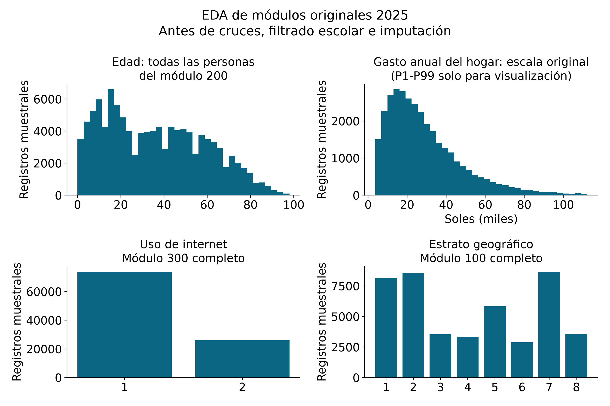

**Figura 1.** EDA de módulos originales antes de cruzar y filtrar la cohorte. El recorte P1-P99 del gasto es sólo visual: no elimina observaciones analíticas. Se conservan valores originales, faltantes y dominios en las tablas de auditoría.

En desarrollo (n=13 105), el no uso ponderado fue 39.6% en área rural y 18.4% en urbana. La figura EDA de la cohorte y los estadísticos previos a imputar acompañan la entrega; son comparaciones descriptivas.

**Competencias: alcance parcial.** P316B/P316C sólo aplica desde 14 años: 5 041 elegibles, 2 097 autorreportes completos de nueve actividades y 77 sin actividades reportadas. Los pases no equivalen a cero competencias y el autorreporte no es una prueba de desempeño. Por ello no se fabricó una etiqueta conjunta para toda la cohorte.

---

## 2. Datos, integración y evaluación reproducible

Se usaron los módulos anuales oficiales ENAHO 2025 (100, 200, 300 y Sumaria), contrastados con el corte 2025 del panel suministrado por el docente, y Padrón/Padlocal ESCALE del Drive [1,2]. La comparación por llaves no encontró diferencias en los campos comunes seleccionados, tras normalizar faltantes y decimales; las filas adicionales del panel de educación no tenían respuestas observadas. Esto verifica las variables utilizadas, no identidad de todos los campos de ambas publicaciones.

Cruce: ENAHO 200 + 300 por persona; 100 + Sumaria por hogar; Padrón + Padlocal por CODLOCAL, luego agregado por UBIGEO y área.

| Paso de construcción | Registros / comprobación |
| --- | --- |
| Personas ENAHO 2025 | 115 145 |
| Edad 6-17 antes / después de residencia | 24 195 / 23 345 |
| Cruces educación, vivienda y Sumaria | educacion: 100.0%; vivienda: 100.0%; sumaria: 100.0% |
| Contexto ESCALE en base integrada | 22 920 / 23 345 (98.2%) |
| Servicios Padrón enlazados a Padlocal | 54 038 / 54 038; conflictos geográficos: 1 |
| Cohorte matriculada y asistente EBR | 16 544; sin declaración CEBA |
| Desarrollo / prueba | 13 105 / 3 439 personas; 3 232 / 808 conglomerados |

**EDA crudo e integridad.** Se verificaron Latin-1, separador punto y coma y coma decimal en los anuales; el panel usa UTF-8 con BOM y coma de separación. Se inspeccionaron faltantes, tipos, dominios, llaves, cuantiles y extremos; los geocódigos conservan ceros iniciales. Se validaron unicidad y cardinalidad; ningún cruce multiplicó personas. Dos supuestos ZIP MINEDU son HTML de bloqueo y se excluyeron. Los estadísticos de campos originales y faltantes se entregan en las tablas de auditoría; el EDA predictivo usa sólo desarrollo.

**Cruce contextual.** ENAHO 200 y 300 se enlazaron por CONGLOME, VIVIENDA, HOGAR y CODPERSO; 100 y Sumaria, por las tres llaves del hogar. Padrón se unió a Padlocal por CODLOCAL y se filtraron servicios activos de primaria/secundaria. La agregación por UBIGEO y área usa suma de alumnos / suma de docentes, proporción pública y coordenadas del Padrón contadas una vez por local validado (43 631 locales). Padlocal valida geografía; no contiene coordenadas, altitud ni conectividad escolar. El conflicto geográfico se excluye de la validación del local, sin inventar valores.

**Antifuga.** Se exige residencia habitual, edad 6-17, P306=P307=1, P308A primaria/secundaria, no declaración CEBA y P314A válido. Se excluyeron la respuesta, las ramas condicionadas P314B/P314D/P315/P316, sus derivados, llaves, coordenadas, mes y campos de escolaridad propios. GroupShuffleSplit (semilla 42) separó conglomerados: solapamiento=0. Cinco folds GroupKFold en desarrollo sustentan ajuste y selección; sus predicciones fuera de fold alimentan la calibración. Mediana/moda, one-hot y escalado se ajustaron sólo en cada entrenamiento.

**Predictores y pesos.** Se conservaron 13 variables individuales, socioeconómicas, de acceso y contexto. Ingreso y gasto per cápita mensual se transformaron con log(1+x). FACPOB07_25 es el peso anual de población. Por familia se compararon entrenamiento uniforme, peso poblacional, balance de clase y ambos, con métricas poblacionales comunes. Se eligió por AP-CV en una configuración representativa y luego se ajustaron hiperparámetros; es una búsqueda secuencial, no exhaustiva ni anidada.

**Transparencia de la revisión.** La misma prueba fue observada en la versión preliminar. Esta revisión amplía la auditoría y la búsqueda en desarrollo; sus cifras de prueba son una reevaluación y no una validación externa virgen. La selección documentada sigue basada en CV.

---

## 3. Clustering: comparación, estabilidad y perfiles

Se compararon K-Means y mezclas gaussianas (GMM), k=2,...,6, con imputación y estandarización ajustadas en desarrollo. Se usaron log ingreso/gasto, altitud, alumnos/docente, proporción pública y acceso a electricidad e internet del hogar. La etiqueta sólo caracteriza los perfiles después del ajuste; los clusters no se incorporaron al clasificador. La regla previa priorizó silueta entre soluciones con grupos de al menos 5%, con Davies-Bouldin como desempate.

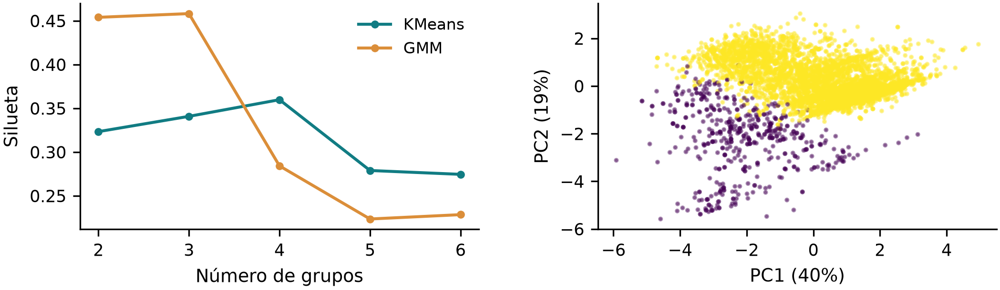

**Figura 2.** Silueta por método y PCA del seleccionado. La comparación estima silueta en 2 500 casos reproducibles. PCA es visualización y explica 59.0% de varianza.

| Mejor elegible | k | Silueta | Davies-B. | Calinski-H. | Mínimo |
| --- | --- | --- | --- | --- | --- |
| GMM | 2 | 0.454 | 1.452 | 3037.7 | 9.7% |
| KMeans | 2 | 0.323 | 1.398 | 5337.3 | 37.9% |

Se seleccionó **GMM, k=2**: silueta 0.454, Davies-Bouldin 1.452 y Calinski-Harabasz 3037.7. Los tres criterios pueden discrepar; no se interpreta una única partición como verdad poblacional. En la tabla, n es muestral y las medias/proporciones son ponderadas dentro de desarrollo.

| Perfil | n | Rural | Internet hogar | Gasto S/ mes* | No uso |
| --- | --- | --- | --- | --- | --- |
| G0: Menor conectividad; rural | 1 271 | 58.9% | 48.6% | 474 | 47.7% |
| G1: Mayor conectividad; urbano | 11 834 | 18.3% | 100.0% | 705 | 21.1% |

* Gasto per cápita. Internet del hogar incluye fijo/móvil; electricidad y conexión son dimensiones de acceso, no competencias digitales.

**Estabilidad.** Se repitió el método/k seleccionado cambiando semilla y ajustando en submuestras de 80% de desarrollo (6 réplicas). El índice Rand ajustado (ARI) frente a la partición original varió entre 1.000 y 1.000. Al quitar electricidad e internet del hogar, la silueta fue 0.279 y el ARI frente al agrupamiento completo 0.081. Esta ablación comprueba dependencia del acceso; no selecciona un nuevo modelo con la etiqueta. Las binarias pueden dominar la geometría, por lo que los nombres de perfiles son descripciones y no tipos sociales esenciales.

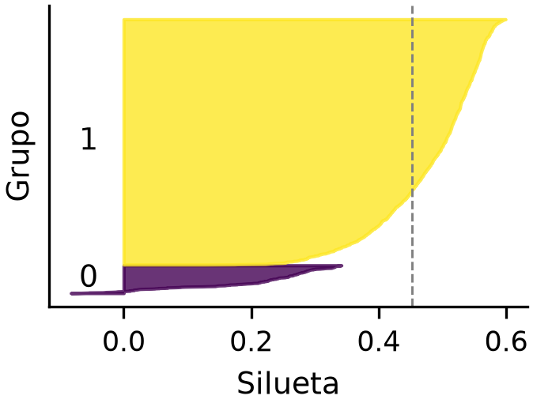

**Figura 3.** Distribución de silueta del método elegido en hasta 1 800 casos. Las diez soluciones y las réplicas se incluyen en las tablas reproducibles.

---

## 4. Clasificación: selección, sensibilidad y errores

Se compararon 16 combinaciones familia-peso y 24 configuraciones HP en cinco folds: 200 ajustes. Se variaron regularización logística, profundidad, hojas y submuestreo en Random Forest, profundidad/regularización en XGBoost y CatBoost. La selección usa AP-CV; parámetros completos en el código. AP y PR-AUC trapezoidal son resúmenes distintos de la curva PR.

| Familia | Peso elegido | Rango AP-CV por peso | Candidatos HP |
| --- | --- | --- | --- |
| CatBoost | balance de clase | 0.582-0.593 | 6 |
| Logística | uniforme | 0.585-0.587 | 6 |
| Random Forest | uniforme | 0.572-0.581 | 6 |
| XGBoost | uniforme | 0.582-0.591 | 6 |

| Modelo | AP-CV ± DE | AUC prueba | PR-AUC prueba | F1 macro |
| --- | --- | --- | --- | --- |
| CatBoost * | 0.5935 ± 0.0109 | 0.820 | 0.601 | 0.693 |
| XGBoost | 0.5931 ± 0.0163 | 0.817 | 0.595 | 0.688 |
| Logística | 0.5886 ± 0.0256 | 0.816 | 0.585 | 0.680 |
| Random Forest | 0.5809 ± 0.0248 | 0.814 | 0.584 | 0.674 |

* Ganador CV nominal: CatBoost; diferencias pequeñas no demuestran superioridad estadística. CV usa scores sin calibrar; prueba usa sigmoide sobre predicciones fuera de fold de desarrollo y umbral 0.5. El orden de prueba no cambia la selección.

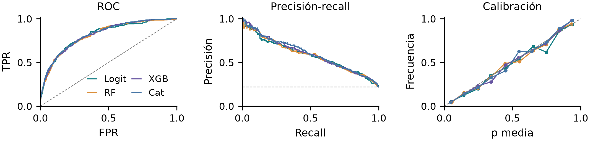

**Figura 4.** ROC, PR y calibración ponderadas. Referencia PR: prevalencia; diagonal de calibración: acuerdo ideal. Logit: logística; RF: Random Forest; XGB: XGBoost; Cat: CatBoost.

El ganador alcanzó AP 0.601 (IC 95% 0.552-0.645) y ROC-AUC 0.820 (IC 0.792-0.846); 300 bootstraps de conglomerados no reproducen todo el diseño estratificado. Brier: 0.162 sin calibrar y 0.127 calibrado; AP sin ponderar=0.665. La constante de prevalencia logra AP=0.220 y Brier=0.172; se prefiere AP para esa referencia porque el trapecio PR es sensible a empates e interpolación.

**Errores al umbral 0.5.**

405 verdaderos positivos, 464 falsos negativos y 185 falsos positivos (conteos). Precisión ponderada=69.1%; recall=38.1%. Omitir no usuarios puede dejar necesidades sin detectar; un falso positivo requiere verificación adicional. El modelo no debe excluir apoyos automáticamente. Las tasas ponderadas no se calculan a partir de esta matriz sin ponderar. No se optimizó el umbral con prueba.

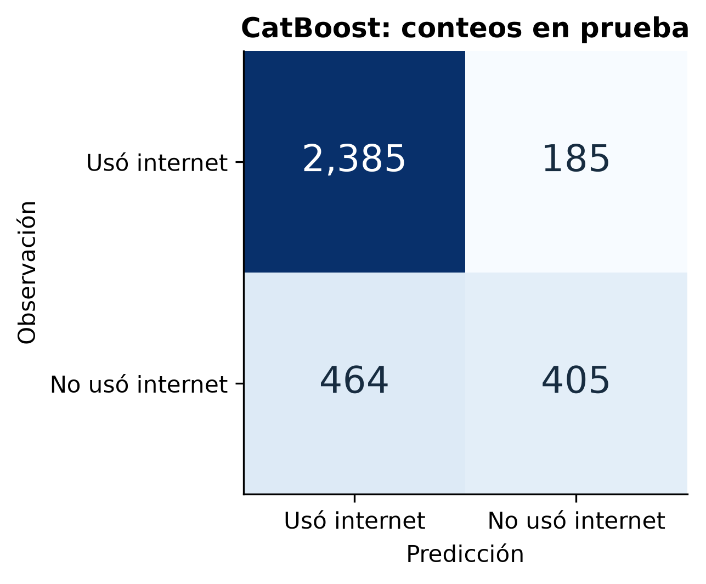

**Figura 5.** Matriz de confusión del ganador. Prueba heredada de la versión preliminar: resultados sujetos a validación externa nueva.

---

## 5. SHAP del ganador e interacciones no lineales

Se explicó CatBoost en 601 casos de prueba, mediante TreeSHAP nativo de CatBoost con su referencia de árboles. Las dummies se sumaron por variable original. Las contribuciones están en **log-odds** antes de calibrar; no son puntos porcentuales de la probabilidad final. Residuo aditivo máximo=6.22e-15. La importancia global es media absoluta no ponderada de SHAP de esta muestra, no efecto poblacional ni causal.

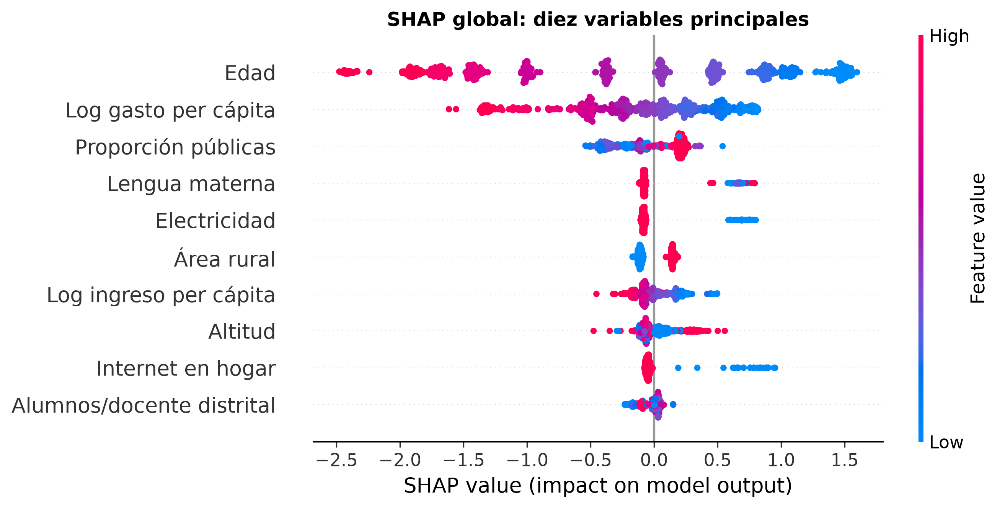

**Figura 6.** Diez variables principales del ganador. Destacan edad, log gasto per cápita, proporción pública. Positivo aumenta el score de no uso; categorías se muestran con sus códigos, no como escala ordinal.

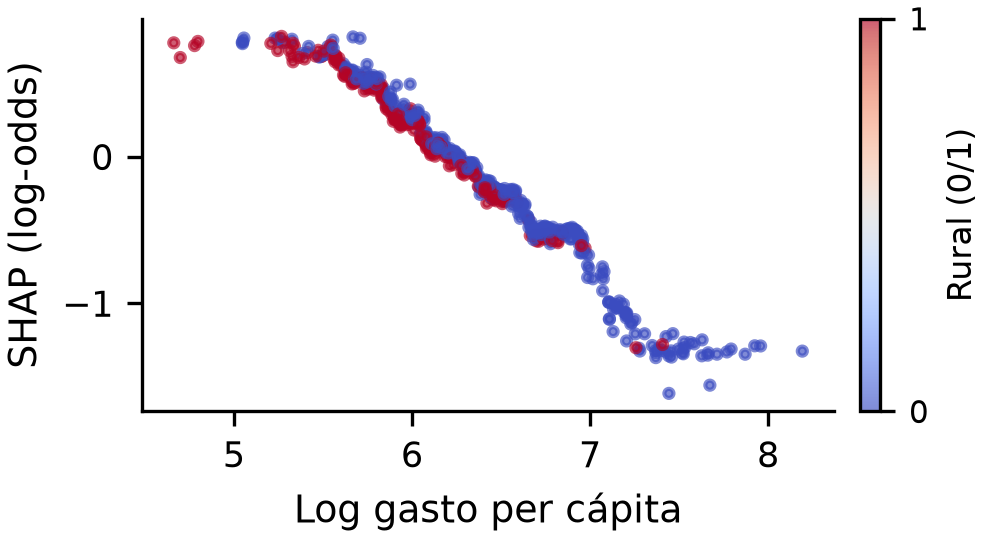

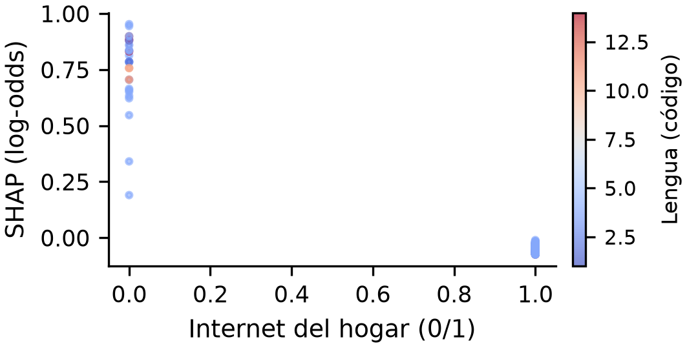

**Análisis no lineal de XGBoost.** Análisis complementario; no sustituye al ganador. En 180 casos, TreeSHAP path-dependent usa cobertura de hojas de desarrollo. La media absoluta de la contribución del par (2φij) fue altitud × proporción pública: 0.039; altitud × alumnos/docente distrital: 0.028. Los pares se eligieron exploratoriamente entre variables de contexto/acceso; no son pruebas de significación.

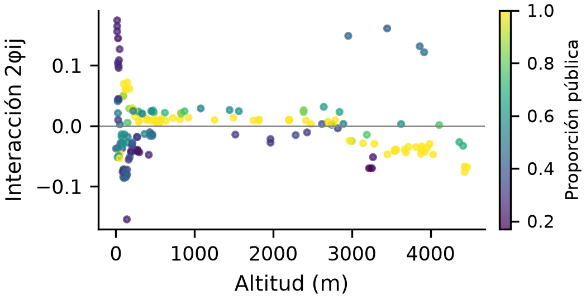

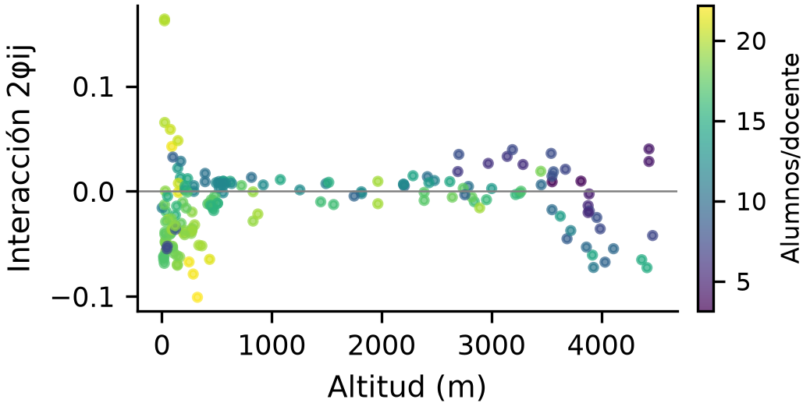

Las interacciones no lineales pertenecen al árbol ajustado, no a personas ni políticas. La suma de interacciones y efectos principales reproduce el score (residuo 2.38e-06). La lengua y otros atributos requieren especial cautela por tamaños minoritarios, correlación y contexto. No se interpretan sus contribuciones como causas ni como criterio para negar servicios.

---

## 6. Casos individuales, conclusiones y límites

**Figuras 11 y 12.** Waterfalls SHAP del score antes de calibrar (log-odds), con cinco contribuciones principales y el resto agregado. Base + contribuciones = score final; la probabilidad calibrada se informa por separado.

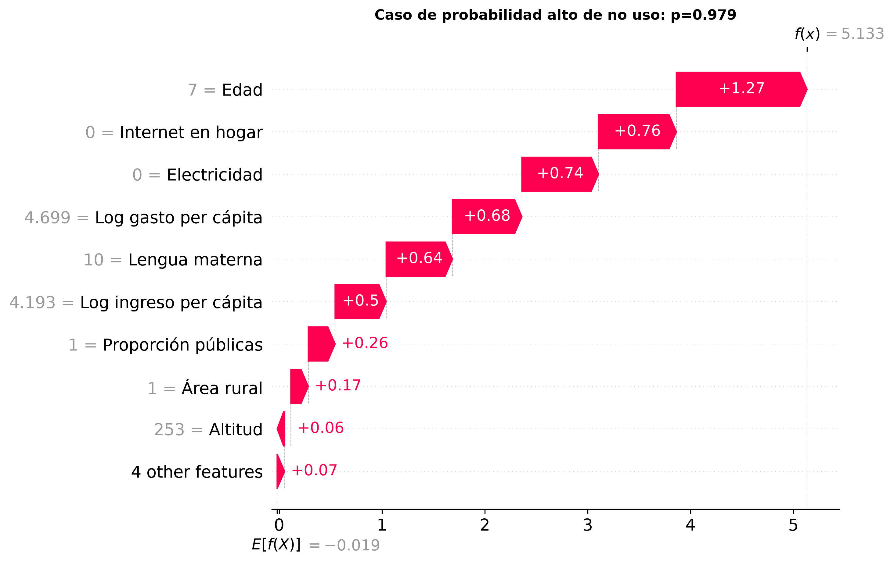

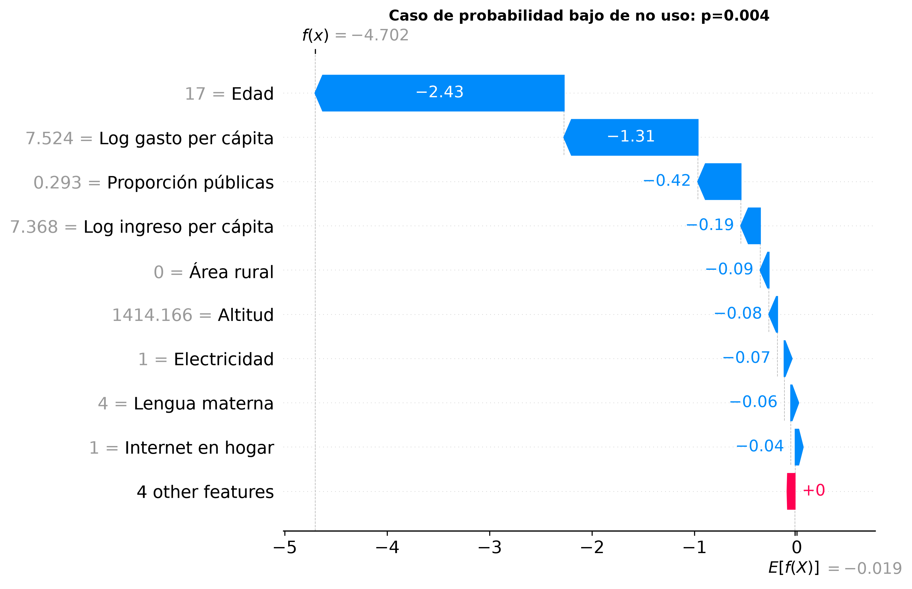

Alto score: edad (+1.27), internet del hogar (+0.76). Bajo score: edad (-2.43), log gasto per cápita (-1.31). Los extremos correctamente clasificados ilustran el modelo, no representan a toda la cohorte. Se omiten nombres, direcciones y cualquier colegio atribuido a una persona.

**Conclusiones.** La integración conserva cardinalidad y separación de conglomerados. Los perfiles presentan no uso entre 21.1% y 47.7% en desarrollo; las réplicas y la ablación permiten valorar su estabilidad. CatBoost fue seleccionado por AP-CV tras comparar pesos e hiperparámetros; su recall ponderado de 38.1% al umbral 0.5 limita la detección individual. La evidencia sugiere explorar apoyos de acceso y acompañamiento apropiados a edad y contexto y evaluar su efecto en campo. SHAP explica el score, no estima el impacto de intervenciones.

**Limitaciones.** No uso en el mes anterior no equivale a falta de habilidades, mala conexión ni exclusión permanente. Se excluyen no asistentes. ESCALE representa residencia, no escuela identificada, e incluye imputaciones; un distrito puede aparecer en ambas particiones. Las estrategias de peso y HP se eligieron secuencialmente en los mismos folds, por lo que CV puede ser optimista. La prueba ya observada en la versión inicial no es una confirmación externa nueva. Los pesos y bootstraps no reproducen todo el diseño muestral. La medición transversal, las referencias temporales y los predictores correlacionados impiden causalidad; se requiere nueva validación espacial/temporal antes de uso decisorio.

## Referencias y materiales reproducibles

[1] INEI. ENAHO anual 2025: módulos 100, 200, 300 y Sumaria, CSV oficiales. Panel 2021-2025 suministrado: contraste del corte 2025. MINEDU. Padrón y Padlocal ESCALE suministrados; archivos, fechas, URLs y hashes en auditoría.

[2] INEI. ENAHO 2025: Diccionario de Datos. Lima, mayo de 2026. [Documento anual oficial](https://proyectos.inei.gob.pe/iinei/srienaho/Descarga/DocumentosMetodologicos/2025-55/20_Diccionario_2025.pdf). Cuestionarios ENAHO.01 y ENAHO.01A 2025 incluidos en los archivos suministrados.

[3] Condori Coaquira, A. R. Guía de Evaluación: Proyecto IA, Brecha Digital y Educación 2025 (ENAHO-ESCALE). Curso Inteligencia Artificial, UPeU. Material docente suministrado, 7 páginas.

[4] INEI. Documento Metodológico de los Indicadores en Educación, 2022, pp. PDF 29 y 33-34. [Metodología oficial](https://www.inei.gob.pe/media/MenuRecursivo/investigaciones/indicadores-de-educacion.pdf). MINEDU/ESCALE: ficha SIAGIE de atraso, edad al 31 de marzo y desfase de al menos dos años.

[5] INEI. ENAHO 2024: Manual de Consistencia Básica. [Criterio de residente habitual](https://proyectos.inei.gob.pe/iinei/srienaho/Descarga/DocumentosMetodologicos/2024-55/14_Manual_Consistencia.pdf); referencia 2024, no manual 2025.

Entrega reproducible: scripts, notebooks, dataset y diccionario, fuentes, métricas/folds, pesos, estabilidad, SHAP y versión editable del artículo. Las tablas completas sustentan las cifras condensadas en seis páginas.
